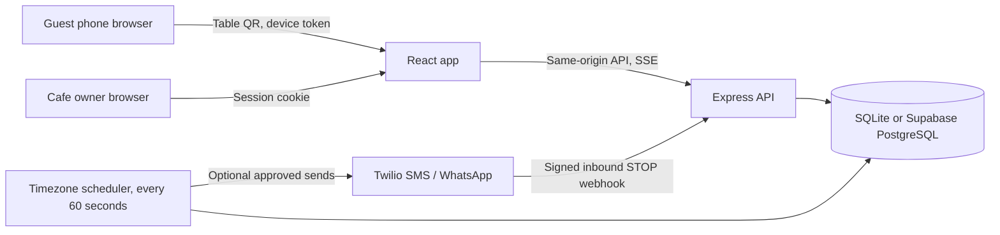

# Architecture and data model

## Stack

- **Web UI:** React 19, React Router 7, Vite 6, Lucide icons, custom responsive CSS.
- **API:** Express 5 on Node.js 22.5+.
- **Database:** SQLite (`node:sqlite`) for local development, or Supabase-hosted PostgreSQL through the `postgres` driver when `DATABASE_URL` is set.
- **Currency defaults:** New cafes start with INR and `Asia/Kolkata`; supported money formatting includes Indian Rupees without forced trailing paise.
- **Validation/auth:** Zod 4 request schemas, scrypt password hashes and 256-bit opaque owner sessions. Session tokens are hashed in the database and sent in an HttpOnly, SameSite=Lax cookie.
- **Messaging:** Optional Twilio REST API for scheduled SMS or approved WhatsApp templates. Manual WhatsApp/SMS composer is the no-credentials path.
- **Tests:** Node's built-in test runner and Playwright with installed Chrome/Edge.

## Runtime shape

In development, Vite listens on 5173 and proxies `/api` to Express at 3001. In production, `npm run build` creates `dist/`; Express serves the UI and API from one origin. The local dashboard's live order board uses server-sent events scoped to the owner's cafe session.

## Tenant boundaries and authentication

- Every owner session resolves to one `cafe_id`; every owner API query includes that ID.
- Customer tokens are random, stored in browser local storage and represented in the database only by SHA-256 hash. Card and order GET requests send them in `X-Cafe-Token`, and return `Cache-Control: no-store`.
- Relational records use composite keys/foreign keys such as `(cafe_id, customer_id)`, so a row cannot link a customer from another cafe.
- Customer deletion cascades through associated records. Passwords use salted scrypt. Owner cookies are HttpOnly and SameSite=Lax; `Secure` is added in production.
- Owner access is enforced in the Express API using café-scoped queries and tenant-aware foreign keys. The Supabase schema enables RLS on every table and intentionally defines no browser/Data API policies; the server-side PostgreSQL connection uses the privileged database role. Never expose its connection string in the browser. If direct browser table access is added later, create and test least-privilege policies first.

## Database entities

| Table | Purpose and important data |
| --- | --- |
| `cafes` | Tenant, slug, branding, currency/timezone, review URL, stamp target, comeback days, message templates, sender and Twilio Content SIDs. |
| `owners` | Owner email, scrypt password hash and role, scoped to a cafe. |
| `sessions` | Hashed opaque owner session, expiry and cafe/owner foreign key. |
| `customers` | One row per cafe/phone, device-token hash, name, optional birthday, visit count, latest visit, favourite item and consent timestamps. |
| `menu_items` | Cafe-owned categories, current price, availability and stamp eligibility. |
| `orders` | Cafe/customer/table/status, authoritative amount and a JSON item snapshot so menu edits do not rewrite order history. |
| `stamps` | One unique stamp per cafe/order; stamps in a reached cycle point to that reward. |
| `rewards` | Unique code, type, status, expiry/redemption timestamps and stamp target snapshot. |
| `reviews` | Scheduled/requested/clicked timestamps and delivery state; tracks taps, not review contents. |
| `offers` | Come-back, birthday and review message content, idempotency key, delivery state, expiry and attributed return. |

SQLite `PRAGMA user_version` records schema version 3. Opening older databases adds `cafes.messaging_from` and India DLT registration fields without deleting records. For Supabase, `server/postgres-schema.sql` creates the same tables and indexes idempotently and records versions in `cafeloop_schema_migrations`; it adds those fields when opening an older project. The CafeLoop schema has been applied to the `CafeLoop` Supabase project (`emgdnxopirmpisvicfei`) and all 11 tables report RLS enabled. Schema setup does not delete existing rows. All relational tables other than the tenant root have a `cafe_id` column. Indexes support customer inactivity, birthday, orders, offers and order status queries.

## Order and loyalty consistency

1. The public order route checks the cafe slug, current available menu IDs and server-side prices before creating a customer or order.
2. Order status can move from `new` to `preparing`, `completed` or `cancelled`. `completed` and `cancelled` are terminal.
3. Completion executes in a database transaction. It updates visit data, recomputes the customer's most frequently purchased item from completed order snapshots and inserts no more than one stamp for that order.
4. If unassigned stamps meet the cafe target, one unique reward is created and the target stamps are attached to it. A repeated completion is a no-op.
5. An available reward shows its full stamp cycle. Once redeemed, its stamps no longer count toward progress.
6. Menu amount is computed at order creation from current database prices, rounded to cents. Client-submitted prices are ignored.

## Automation behavior

- A 60-second scheduler runs inside the Express process and uses each cafe's IANA timezone.
- Come-back eligibility: consent true, last visit at least `comeback_days` ago, and no queued/opened/sent come-back offer in the last 14 days. It creates a 20%-off reward and message valid for 7 days.
- Birthday eligibility: consent true and birthday day/month match the cafe's local date. It creates a free-drink reward valid for 7 days.
- Review request: one row is scheduled on a consenting customer's second completed visit for two hours later. A later opt-out suppresses the request.
- Unique offer idempotency keys prevent duplicate daily jobs if the scheduler checks the same cafe more than once.
- Job processing runs in the single Express scheduler process. If the process is offline at the scheduled time, the next tick catches up after startup. Keep one scheduler instance to avoid duplicate work.
- Scheduled Twilio sends remain queued unless `TWILIO_AUTOMATIONS_ENABLED=true`; clicking an explicit owner send action may still use Twilio immediately.
- If Twilio is unavailable or a WhatsApp Content SID is missing, the message remains queued for owner review. `opened` means the composer was opened; only a Twilio response is recorded as `sent`.

## Metrics definitions

- **Today's orders:** all non-cancelled orders created in the cafe's local day.
- **Today's revenue / average order:** completed orders only; average is completed revenue divided by completed order count.
- **Repeat customers:** distinct customers with at least two completed orders this calendar month divided by distinct customers with at least one completed order this month.
- **Top five:** completed line-item quantities since local Monday.
- **Win-backs:** come-back offers with an attributed order this calendar month.
- **Review taps and rewards redeemed:** corresponding event timestamps in the cafe's local calendar month.

## Twilio configuration

Set `TWILIO_ACCOUNT_SID`, `TWILIO_AUTH_TOKEN` and `TWILIO_FROM` on the server. The optional café sender override chooses a sender that is already provisioned in Twilio; it does not create a phone number or WhatsApp sender. WhatsApp requires a connected WhatsApp Business sender and approved Content SIDs. For SMS to Indian +91 recipients, the cafe settings store a DLT PE ID and approved template IDs; sends remain queued when the applicable IDs are missing. Set `TWILIO_AUTOMATIONS_ENABLED=true` only after reviewing channel, consent, templates, and test recipients. Set `APP_PUBLIC_URL` to the exact public HTTPS origin for Twilio signature validation and route inbound messages to `/api/webhooks/twilio/inbound`. The webhook validates `X-Twilio-Signature` before acting on `STOP`.

Twilio delivery was not tested against a live account because credentials were not supplied. The queued message and manual composer paths are exercised in the local test suite.
